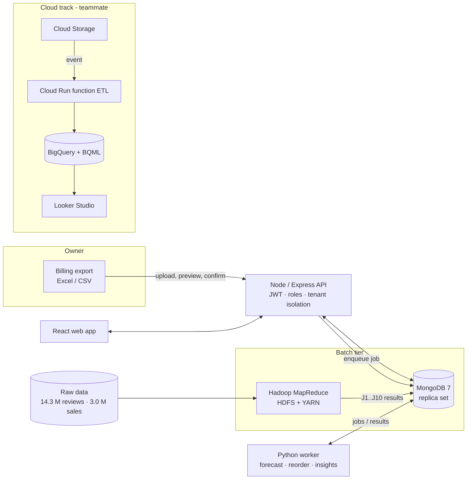

# RetailPulse

A decision assistant for supermarkets and kirana stores: upload what your billing software already knows, and RetailPulse learns your shop, then tells you **what to order, what is about to expire, and why** - in plain words.

One project, three academic evaluations: **Full Stack Development**, **Big Data Tools & Techniques** (Hadoop MapReduce + MongoDB) and **Cloud Computing for Data Analytics**.

> **Honesty note.** No public dataset contains stock, expiry or waste records, so those fields come from a clearly labelled **simulation** (`simulated: true` on every record, a purple badge in the UI). The simulation is built on top of *real* data: 3.0 M real grocery sales rows and 14.3 M real product reviews. Nothing here is evidence about the savings a real shop would see.

## Architecture

- **MongoDB** is the only operational data store. **Hadoop** is the batch tier (reviews, sales aggregates, waste report) - it does not sit on the per-shop path; results are loaded into MongoDB by a script (the MongoDB-Hadoop connector is archived).
- **Learning is automatic**: every sales/stock import queues a job; the owner never presses "train".

## Quick start
```bash
# everything in containers
cp retailpulse/infra/.env.example retailpulse/infra/.env     # set JWT_SECRET
docker compose -f retailpulse/infra/docker-compose.yml --env-file retailpulse/infra/.env up --build
# web: http://localhost:8080   (register a shop and upload your own files)
```
Local development (what was used to build it): MongoDB 7 container (replica set), `node retailpulse/backend/src/server.js`, `npm run dev` in `retailpulse/frontend`, `python retailpulse/engine/worker.py`, Hadoop via `retailpulse/infra/stack.sh`.
Demo shops (simulated; need `data/` regenerated, see below): `owner@demo-a.retailpulse.test` / `owner@demo-b.retailpulse.test`, password `Demo@1234` (local demo only).

## Reproduce the data pipeline
1. `kaggle competitions download -c store-sales-time-series-forecasting` and the Amazon Reviews 2023 *Grocery_and_Gourmet_Food* files (Hugging Face `McAuley-Lab/Amazon-Reviews-2023`) into `retailpulse/data/raw/` (not in git).
2. `python data_prep/profile_sources.py` · `python simulation/generate.py demo-a|demo-b` · `python simulation/make_exports.py demo-a`
3. `hadoop/scripts/load_hdfs.sh` · `hadoop/scripts/run_all.sh` (ten jobs) · `python validation/validate_jobs.py` (independent recomputation)
4. `python loaders/load_amazon_meta.py` · `load_reviews_sample.py 0.14` · `load_sim.py demo-a` · `load_mr_results.py`
5. `python engine/pipeline.py demo-a` · `python engine/favorita_eval.py`

## External research datasets (Hadoop demo)
Eleven further datasets were reviewed (Instacart, Dunnhumby, Online Retail II, M5, Real Canadian Superstore, BigBasket, synthetic inventory sets…); eight are processed by 13 extra Hadoop jobs (`hadoop/scripts/run_ext.sh`, validated by `validation/validate_external.py`). See `docs/research/04_external_datasets.md`. Prepare with `python data_prep/prepare_external.py`, load with `python loaders/load_external.py`. Demo shops: A (single store), B (3-store chain), **C (Indian catalogue, ₹)**.

## Tests
`cd retailpulse/backend && npm test` (47) · `cd retailpulse && pytest` (Hadoop job logic, engine incl. no-future-leakage, simulator checks, cloud ETL) · `node retailpulse/e2e/ingest_flow.mjs` (new-owner journey) · `node retailpulse/e2e/screenshots.mjs`.

## Where to look
| | |
|---|---|
| `docs/` | research, plans, **decision log, development log, trial & error log**, evidence summary (`docs/report/EVIDENCE_SUMMARY.md`) |
| `retailpulse/hadoop/` | MapReduce jobs + runners | 
| `retailpulse/engine/` | forecasting, reorder logic, job worker |
| `retailpulse/backend/`, `frontend/` | API and web app |
| `retailpulse/cloud/` | cloud function, BigQuery SQL, **runbook for the teammate** |
| `retailpulse/evidence/` | machine-generated evidence (profiles, Hadoop logs, validation, tests, screenshots) |

## Data sources & licences
Amazon Reviews 2023 (Hou et al., 2024; McAuley Lab) - licence not stated on the dataset card, academic use, cite the paper. Store Sales - Kaggle competition data (Corporación Favorita), subject to the competition rules. Raw data is not redistributed in this repository.
